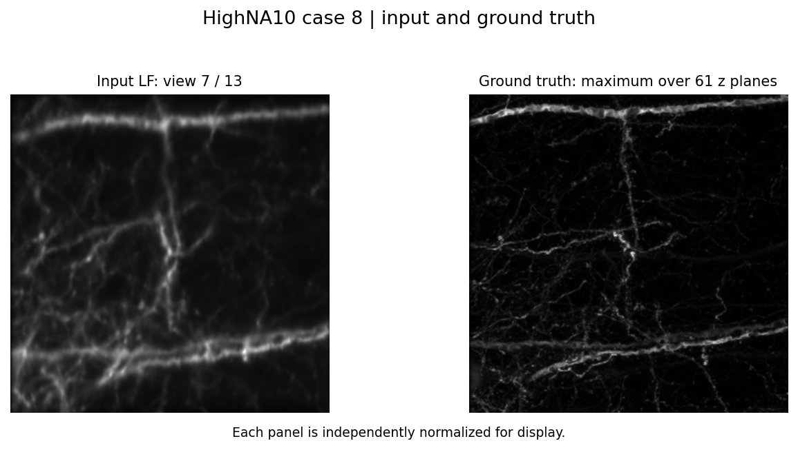

# HighNA10 case 8

This example uses the original `8_z61.tif` selected by
`settings/highna_fp.json`. Its input, all 13 PSFs and ground truth are bundled
in this folder, so the example can run immediately after cloning the
repository and installing the dependencies. No Zenodo download is needed
for this case.



The preview shows one measured LF view and a maximum-intensity projection
of the ground truth. It does not show a reconstruction result.

## Run

Use the repository's documented environment: Python >= 3.9, PyTorch >= 2.0
with CUDA, and `pip install -r requirements.txt`. Run these commands from
the repository root.

Full reconstruction with the original HighNA settings:

```bash
python recon.py --config examples/highna_case8/config.json
```

This runs 100 epochs with 100 iterations each, enables PSNR/SSIM evaluation,
and uses seed 0. It reconstructs the full 61 x 512 x 512 volume. The original
configuration processes the volume together and needs substantial free GPU
memory.

For a short execution check:

```bash
python recon.py --config examples/highna_case8/quick_check.json
```

The check uses the same full-resolution measurement and PSFs, one epoch,
one iteration, depth batching, and no ground-truth evaluation. It starts in
the fine stage to keep the depth batches consistent. This checks data
loading, CUDA optimization and output writing; the result is undertrained
and does not establish reconstruction quality.

The quick check completed on an RTX 2080 Ti in the local environment and
wrote a finite float32 volume of shape 61 x 512 x 512. That local runtime
uses Python 3.8 / PyTorch 1.10, below the documented supported versions, and
emits a complex-to-real casting warning; the one-iteration output also
contains negative values. Use the documented environment
for full reconstructions; the full 100-epoch configuration has not been
validated in this session.

To select a different CUDA device, append `--gpu_id 1` (or another index).

## Files and results

| File | Array shape | Purpose |
| --- | --- | --- |
| `data/measurement.tif` | 13 x 512 x 512 | Original LF measurement, case 8 |
| `data/psf/psf_1.tif` ... `psf_13.tif` | 61 x 256 x 256 each | All angular PSFs |
| `data/ground_truth.tif` | 61 x 512 x 512 | Original ground-truth volume |
| `config.json` | | Full reconstruction settings |
| `quick_check.json` | | Short execution-check settings |
| `data_manifest.json` | | Original paths, array shapes and file sizes |

All TIFFs use lossless DEFLATE compression and retain the original float32
array values; every bundled array was compared with its source after
compression. The total data size is about 236 MiB. No separate Git LFS setup
is required.

Outputs are written to `Results/<timestamp>_LFP_..._measurement_<tag>/`.
Both configurations write `config.json`, epoch TIFFs and
`measurement_recon.tif`. The full configuration additionally writes
`best.tif`, `eval_log.txt` and `eval.txt` when evaluation succeeds.

The full collection of measurements, PSFs and ground truth is available at
[Zenodo: LF-PINE](https://doi.org/10.5281/zenodo.23034780).
